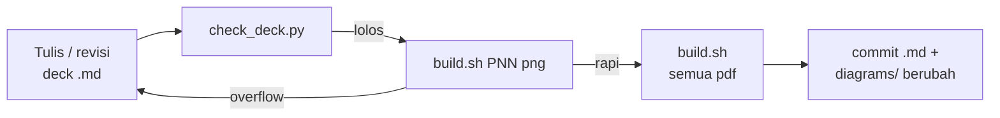

# Standar Slide Kuliah (Marp) — Playbook Replikasi

Dokumen ini mendeskripsikan lengkap pola pembuatan slide kuliah dengan
[Marp](https://marp.app) yang dipakai di mata kuliah Pemrograman Perangkat
Bergerak (folder `slides/`), sehingga bisa direplikasi utuh untuk mata kuliah
lain. Semua script dan style disertakan apa adanya — tinggal salin dan ganti
bagian yang ditandai **[ADAPTASI]**.

---

## 1. Prinsip

1. **Satu sumber kebenaran berupa teks.** Slide ditulis dalam Markdown biasa,
   bukan tool presentasi biner. `git diff` tetap berguna, revisi bisa
   di-review, dan konten bisa disalin dari materi kuliah yang sudah Markdown.
2. **Satu sumber, banyak keluaran.** File `.md` yang sama menghasilkan PDF
   (arsip/bahan bagikan), HTML (mode presentasi di kelas), PPTX (setoran),
   dan PNG (pemeriksaan overflow).
3. **Dense by design.** Slide berfungsi ganda: memandu saat mengajar dan
   menjadi referensi belajar setelah kelas. Konsekuensinya ada satu aturan
   mutlak: *tiap slide kode wajib punya minimal satu kalimat "kenapa"* —
   bukan kode telanjang.
4. **Tampilan dikunci oleh theme, bukan oleh deck.** Logo institusi, warna,
   footer, dan tipografi hidup di satu file CSS. Penulis deck tidak pernah
   menulis styling manual; 14 deck bisa ganti kulit dengan mengubah 1 file.
5. **Diagram pre-render, bukan render di browser.** Blok ```mermaid diganti
   SVG statis saat build (alasannya di §8) agar hasil identik di semua
   format dan tidak butuh internet saat mengajar.

## 2. Struktur Direktori

```
slides/
├── PNN-slug.md            # satu deck per pertemuan (P01, P02, ...)
├── README.md              # konvensi + tabel status deck mata kuliah ini
├── build.sh               # wrapper marp-cli: pdf/html/pptx/png, per deck atau semua
├── marp.config.js         # daftarkan theme + ganti fence mermaid jadi 
├── themes/
│   └── ppb.css            # [ADAPTASI] theme: kanvas, warna, logo, class layout
├── tools/
│   └── render_diagrams.py # pre-render mermaid → diagrams/<hash>.svg
├── diagrams/              # SVG hasil render (di-commit; deterministik per hash)
├── vendor/
│   └── mermaid.min.js     # mermaid di-vendor (±4 MB), render offline
├── assets/
│   └── logo-udinus.png    # [ADAPTASI] logo institusi, dipasang dari theme
└── build/                 # hasil render, TIDAK di-commit (di-gitignore)
```

Catatan:

- `diagrams/` **di-commit**. Nama file adalah hash SHA-1 (12 karakter) dari
  definisi mermaid — deterministik, hanya definisi yang berubah yang dirender
  ulang, dan `git diff` menunjukkan diagram mana yang berubah.
- `vendor/mermaid.min.js` diunduh sekali dari
  `https://cdn.jsdelivr.net/npm/mermaid@11/dist/mermaid.min.js` (versi yang
  dipakai PPB: 11.17.2). Di-vendor agar build tidak bergantung internet.
- `build/` di-ignore lewat `.gitignore` root (`build/`).

## 3. Prasyarat

- **Node.js + npx** — marp-cli dijalankan lewat
  `npx -y @marp-team/marp-cli@latest`; tidak ada `npm install`, tidak ada
  `package.json`.
- **Google Chrome** — wajib untuk keluaran PDF/PPTX/PNG (marp-cli memakai
  headless Chrome), dan dipakai `render_diagrams.py` (path Mac hardcoded;
  di Linux ganti ke `chromium`/`google-chrome`, lihat script).
- **Python 3** — untuk pre-render diagram (tanpa dependensi pihak ketiga).

## 4. File Konfigurasi

### 4.1 `marp.config.js`

Dua tugas: mendaftarkan direktori theme, dan mengganti fence ```mermaid
menjadi `` SVG pre-render. Tanpa penggantian ini, mermaid akan dirender
di browser dan labelnya mewarisi CSS halaman (lihat §8).

```js
// Konfigurasi Marp untuk deck kuliah.
// Blok ```mermaid tidak dirender di browser, melainkan diganti dengan SVG yang
// sudah di-pre-render oleh tools/render_diagrams.py. Alasannya ada di komentar
// file itu: label mermaid mewarisi CSS halaman dan jadi terpotong.
const crypto = require('crypto');

const digest = (source) =>
  crypto.createHash('sha1').update(source.trim()).digest('hex').slice(0, 12);

module.exports = {
  themeSet: './themes',
  html: true,            // deck memakai <div class="note|warn|ok"> dst.
  allowLocalFiles: true, // agar logo & SVG lokal terbaca saat ekspor
  engine: ({ marp }) =>
    marp.use((md) => {
      const fence = md.renderer.rules.fence;
      md.renderer.rules.fence = (tokens, idx, options, env, self) => {
        const token = tokens[idx];
        if (token.info.trim() === 'mermaid') {
          const src = `diagrams/${digest(token.content)}.svg`;
          return `<p class="diagram"></p>`;
        }
        return fence(tokens, idx, options, env, self);
      };
    }),
};
```

marp-cli otomatis memuat `marp.config.js` dari direktori kerja — `build.sh`
selalu `cd` ke direktorinya sendiri dulu.

### 4.2 `themes/ppb.css` → **[ADAPTASI]** jadi `themes/<mata-kuliah>.css`

Bagian yang wajib disesuaikan: (a) nama theme di baris komentar pertala
`/* @theme ppb */` — harus sama dengan nilai `theme:` di frontmatter deck;
(b) palet variabel `--ppb-*` (ambil dari warna logo institusi); (c) path logo;
(d) nama font bila institusi punya standar lain.

```css
/* @theme ppb */                       /* [ADAPTASI] ganti nama theme */
/* Theme slide kuliah — Universitas Dian Nuswantoro.
   Kanvas 4:3 (1024x768) menyesuaikan proyektor lab.
   Dirancang untuk konten padat: narasi + potongan kode, terbaca dari
   bangku belakang (kode minimum 16px). */

@import 'default';

:root {
  /* [ADAPTASI] warna diambil dari logo institusi */
  --ppb-primary: #14529c;
  --ppb-accent: #f2b736;
  --ppb-ink: #1a1a1a;
  --ppb-muted: #5f6b7a;
  --ppb-rule: #d9e2ec;
  --ppb-code-bg: #f6f8fa;
  --ppb-code-border: #c8d6e5;
  --ppb-warn: #c62828;
  --ppb-ok: #2e7d32;

  font-family: 'Inter', 'Helvetica Neue', Arial, sans-serif;
  font-size: 21px;
  color: var(--ppb-ink);
}

section {
  width: 1024px;
  height: 768px;
  padding: 44px 48px 62px;
  background: #fff;
  /* Override default Marp `place-content: safe center center` agar slide
     berkonten sedikit sejajar atas, konsisten dengan slide padat. */
  display: block;
  place-content: start;
  line-height: 1.45;

  /* Logo institusi kecil di tiap slide isi. Jangan turunkan di bawah ~50px:
     elemen teks pada logo jadi tak terbaca. */
  background-image: url('assets/logo-udinus.png');  /* relatif ke slides/ */
  background-repeat: no-repeat;
  background-position: right 48px bottom 12px;
  background-size: 52px 52px;
}

section h1 { font-size: 34px; color: var(--ppb-primary); margin: 0 0 16px; }
section h2 {
  font-size: 27px; color: var(--ppb-primary);
  margin: 0 0 14px; padding-bottom: 7px;
  border-bottom: 2px solid var(--ppb-rule);
}
section h3 { font-size: 21px; color: var(--ppb-ink); margin: 0 0 7px; }

section p { margin: 0 0 11px; }
section ul, section ol { margin: 0 0 11px; padding-left: 1.15em; }
section li { margin-bottom: 5px; }
section li > ul { margin-top: 5px; }

strong { color: var(--ppb-primary); }
em { color: var(--ppb-muted); font-style: normal; }

/* --- Kode: light theme, kontras tinggi untuk proyektor lama --- */
section pre {
  color-scheme: light; /* kunci palet highlight ke terang walau OS dark mode */
  background: var(--ppb-code-bg);
  border: 1px solid var(--ppb-code-border);
  border-left: 4px solid var(--ppb-primary);
  border-radius: 5px;
  padding: 12px 15px;
  margin: 0 0 11px;
  font-size: 16px;
  line-height: 1.42;
  overflow: visible;
}
section pre code {
  font-family: 'JetBrains Mono', 'Fira Code', Consolas, monospace;
  background: none; color: #1f2328;
}
section code {
  font-family: 'JetBrains Mono', 'Fira Code', Consolas, monospace;
  background: #eaf1f9; color: #0b4a86;
  padding: 1px 4px; border-radius: 3px; font-size: 0.92em;
}

/* Diagram: SVG pre-render dipasang sebagai  — CSS halaman tidak bisa
   bocor ke dalamnya dan merusak ukuran label. */
section p.diagram { text-align: center; margin: 4px 0 14px; }
section p.diagram img { max-width: 100%; height: auto; }

/* Kode panjang: turunkan font agar tetap satu layar */
section.code-dense pre { font-size: 14px; line-height: 1.34; }

/* --- Layout dua kolom: kode kiri, anotasi kanan --- */
section.split {
  display: grid;
  grid-template-columns: 1fr 1fr;
  grid-template-rows: auto 1fr;
  column-gap: 22px;
  align-content: start;
}
section.split h2 { grid-column: 1 / -1; }
section.split > *:nth-child(n+2) { min-width: 0; }
section.split-wide { grid-template-columns: 3fr 2fr; }
section.split pre { font-size: 14px; line-height: 1.36; align-self: start; }

/* --- Slide judul & pembatas segmen: latar gelap --- */
section.title,
section.section-break {
  display: flex;
  flex-direction: column;
  place-content: safe center center;
  text-align: left;
  background-color: #0f4589;
  background-image:
    url('assets/logo-udinus.png'),   /* logo besar di pojok kanan atas */
    linear-gradient(135deg, #0b3468 0%, #1a63b8 100%);
  background-repeat: no-repeat, no-repeat;
  background-position: right 48px top 44px, center;
  background-size: 128px 128px, cover;
  color: #fff;
}
/* Footer disembunyikan di slide gelap: abu-abu redup tak terbaca di biru tua */
section.title footer,
section.section-break footer { display: none; }
section.title h1,
section.section-break h1 { color: #fff; font-size: 44px; border: none; }
section.title h2,
section.section-break h2 { color: #ffd98a; border: none; font-size: 23px; }
section.title code,
section.section-break code { background: rgba(255,255,255,.15); color: #fff; }
section.title strong,
section.section-break strong { color: #fff; }

/* Baris identitas pengajar di slide judul */
.pengajar {
  margin-top: 26px; padding-top: 14px;
  border-top: 1px solid rgba(255,255,255,.35);
  font-size: 19px; line-height: 1.5;
}
.pengajar strong { color: var(--ppb-accent) !important; }

/* --- Kotak penanda --- */
.note, .warn, .ok {
  border-left: 4px solid var(--ppb-primary);
  background: #f2f6fb;
  padding: 9px 14px; margin: 0 0 11px; font-size: 0.95em;
}
.warn { border-left-color: var(--ppb-warn); background: #fdf1f1; }
.ok   { border-left-color: var(--ppb-ok);   background: #f1f8f2; }

/* --- Tabel --- */
section table { font-size: 0.88em; border-collapse: collapse; margin-bottom: 11px; }
section th { background: #eaf1f9; color: var(--ppb-primary); text-align: left; }
section th, section td { border: 1px solid var(--ppb-rule); padding: 5px 10px; }

/* --- Footer & nomor halaman --- */
section footer { color: var(--ppb-muted); font-size: 13px; }
section::after {
  color: var(--ppb-muted); font-size: 14px;
  right: 112px;   /* beri ruang untuk logo di pojok kanan bawah */
  bottom: 24px;
}
```

> **Catatan path logo:** Marp me-resolve `url()` di theme relatif ke file
> Markdown yang dirender — maka di repo PPB path-nya `assets/logo-udinus.png`
> (relatif ke root `slides/`), bukan relatif ke `themes/`. Setelah menyalin,
> uji dengan `./build.sh P01 png` dan pastikan logo muncul di halaman 1
> (mis. cek dengan `pdfimages -list`).

### 4.3 `build.sh`

```bash
#!/usr/bin/env bash
# Render deck slide ke build/. Tanpa argumen: semua deck.
#   ./build.sh                    -> semua deck, format pdf
#   ./build.sh P03                -> hanya P03, format pdf
#   ./build.sh P03 html           -> P03 ke html (mode presentasi di kelas)
#   ./build.sh all pptx           -> semua deck ke pptx
set -euo pipefail
cd "$(dirname "$0")"

target="${1:-all}"
format="${2:-pdf}"
mkdir -p build

# Diagram di-pre-render lebih dulu; hanya yang definisinya berubah
# yang dirender ulang.
python3 tools/render_diagrams.py

case "$format" in
  pdf|html|pptx|png) ;;
  *) echo "format tidak dikenal: $format (pdf|html|pptx|png)" >&2; exit 1 ;;
esac

if [ "$target" = "all" ]; then
  decks=(P*.md)
else
  decks=("$target"*.md)
fi

for deck in "${decks[@]}"; do
  name="$(basename "$deck" .md)"
  case "$format" in
    png) out="build/$name.png" ;;
    *)   out="build/$name.$format" ;;
  esac
  echo "==> $deck -> $out"
  npx -y @marp-team/marp-cli@latest "$deck" \
    $([ "$format" = "png" ] && echo "--images png" || echo "--$format") \
    -o "$out"
  # HTML di build/ tidak bisa menemukan assets/ dan diagrams/ yang direferensikan
  # relatif oleh theme dan diagram — ikatkan salinannya.
  if [ "$format" = "html" ]; then
    cp -R assets diagrams "build/"
  fi
done
```

### 4.4 `tools/render_diagrams.py`

Murni stdlib Python. Merender semua fence ```mermaid dari deck ke
`diagrams/<hash>.svg` memakai headless Chrome, hanya yang belum ada.

```python
#!/usr/bin/env python3
"""Pre-render blok ```mermaid di deck menjadi SVG statis di `diagrams/`.

Kenapa tidak dirender di browser saat slide ditayangkan:
mermaid menghitung ukuran kotak node dengan mengukur lebar teks. Label node
berada di dalam <foreignObject>, sehingga mewarisi CSS halaman — termasuk
font-size theme (mis. 21px). Mermaid mengukur pada ukurannya sendiri (16px),
jadi kotak dihitung ~30% lebih sempit daripada teks yang akhirnya dirender,
dan labelnya terpotong. Gejalanya paling parah di ekspor PDF.

Dengan merender di halaman kosong tanpa theme, pengukuran dan render memakai
font yang sama, sehingga SVG konsisten secara internal. SVG itu lalu dipasang
sebagai , dan CSS halaman tidak bisa lagi bocor ke dalamnya.

Label memakai <text> SVG native (htmlLabels: false), bukan foreignObject:
teks dalam foreignObject diletakkan ulang saat Chrome mencetak SVG ke PDF dan
pernah terpotong dari kotak nodenya; <text> diukur dan digambar oleh mesin
yang sama sehingga tidak bisa bergeser.

Pemakaian: python3 tools/render_diagrams.py [deck.md ...]
Tanpa argumen: semua P*.md.
"""

import glob
import hashlib
import http.server
import os
import re
import shutil
import subprocess
import sys
import tempfile
import threading
import xml.dom.minidom

HERE = os.path.dirname(os.path.dirname(os.path.abspath(__file__)))
DIAGRAMS = os.path.join(HERE, 'diagrams')
CHROME = '/Applications/Google Chrome.app/Contents/MacOS/Google Chrome'
FENCE = re.compile(r'^```mermaid\n(.*?)^```', re.M | re.S)

PAGE = """<!DOCTYPE html>
<html><head><meta charset="utf-8">
<style>
  /* Halaman sengaja polos: tidak ada yang boleh memengaruhi pengukuran teks. */
  body {{ font-family: 'Helvetica Neue', Arial, sans-serif; font-size: 16px; margin: 0; }}
</style></head>
<body>
{bodies}
<script src="mermaid.min.js"></script>
<script>
  mermaid.initialize({{
    startOnLoad: false,
    theme: 'base',
    fontFamily: 'Helvetica Neue, Arial, sans-serif',
    flowchart: {{ useMaxWidth: false, padding: 14, htmlLabels: false }},
    themeVariables: {{
      primaryColor: '#e8f0fa',
      primaryBorderColor: '#14529c',
      primaryTextColor: '#1a1a1a',
      lineColor: '#14529c',
      fontFamily: 'Helvetica Neue, Arial, sans-serif',
      fontSize: '14px',
    }},
  }});
  mermaid.run({{ querySelector: '.d' }}).then(function () {{
    document.title = 'SIAP';
  }});
</script></body></html>"""


def digest(source: str) -> str:
    return hashlib.sha1(source.strip().encode()).hexdigest()[:12]


def collect(files):
    """Kembalikan {hash: definisi} untuk semua diagram di deck yang diberikan."""
    found = {}
    for path in files:
        for match in FENCE.finditer(open(path).read()):
            body = match.group(1).strip()
            found[digest(body)] = body
    return found


def serve(directory):
    handler = lambda *a, **kw: http.server.SimpleHTTPRequestHandler(
        *a, directory=directory, **kw)
    server = http.server.ThreadingHTTPServer(('127.0.0.1', 0), handler)
    threading.Thread(target=server.serve_forever, daemon=True).start()
    return server, server.server_address[1]


def render(pending):
    """Render definisi yang belum punya SVG, tulis ke diagrams/<hash>.svg."""
    workdir = tempfile.mkdtemp(prefix='mermaid-')
    try:
        shutil.copy(os.path.join(HERE, 'vendor', 'mermaid.min.js'), workdir)
        bodies = '\n'.join(
            f'<pre class="d" id="d{key}">{body}</pre>' for key, body in pending.items())
        with open(os.path.join(workdir, 'index.html'), 'w') as handle:
            handle.write(PAGE.format(bodies=bodies))

        server, port = serve(workdir)
        try:
            dom = subprocess.run(
                [CHROME, '--headless', '--disable-gpu', '--no-sandbox',
                 '--virtual-time-budget=20000', '--dump-dom',
                 f'http://127.0.0.1:{port}/index.html'],
                capture_output=True, text=True, timeout=180).stdout
        finally:
            server.shutdown()

        os.makedirs(DIAGRAMS, exist_ok=True)
        written = 0
        for key in pending:
            match = re.search(
                r'id="d%s"[^>]*>(<svg.*?</svg>)' % key, dom, re.S)
            if not match:
                print(f'  GAGAL merender {key}', file=sys.stderr)
                continue
            svg = match.group(1)
            # Label edge mermaid memuat <br> tanpa penutup; sebagai file .svg
            # (XML ketat) Chrome menolak keseluruhan gambar dan menampilkan
            # alt text. Tutup sendiri sebelum divalidasi.
            svg = re.sub(r'<br\s*>', '<br/>', svg)
            try:
                xml.dom.minidom.parseString(svg)
            except Exception as e:
                print(f'  GAGAL validasi XML {key}: {e}', file=sys.stderr)
                continue
            with open(os.path.join(DIAGRAMS, f'{key}.svg'), 'w') as handle:
                handle.write('<?xml version="1.0" encoding="UTF-8"?>\n')
                handle.write(svg)
            written += 1
        return written
    finally:
        shutil.rmtree(workdir, ignore_errors=True)


def main():
    files = sys.argv[1:] or sorted(glob.glob(os.path.join(HERE, 'P*.md')))
    if not os.path.exists(CHROME):
        sys.exit(f'Google Chrome tidak ditemukan di {CHROME}')

    diagrams = collect(files)
    pending = {
        key: body for key, body in diagrams.items()
        if not os.path.exists(os.path.join(DIAGRAMS, f'{key}.svg'))
    }
    if not pending:
        print(f'{len(diagrams)} diagram, semuanya sudah ter-render.')
        return
    print(f'{len(diagrams)} diagram, {len(pending)} perlu dirender...')
    print(f'  {render(pending)} SVG ditulis ke diagrams/')


if __name__ == '__main__':
    main()
```

### 4.5 `.vscode/settings.json` (di root repo)

Ekstensi Marp VS Code tidak membaca `marp.config.js` — tanpa registrasi ini,
preview VS Code jatuh ke theme default (logo hilang, footer muncul di slide
judul) dan mermaid tampil sebagai kode.

```json
{
  "markdown.marp.enableHtml": true,
  "markdown.marp.themes": ["slides/themes/ppb.css"]
}
```

### 4.6 `.gitignore`

Cukup satu baris di `.gitignore` repo (bukan di dalam `slides/`):

```gitignore
build/
```

## 5. Konvensi Penulisan Deck

Satu deck = satu pertemuan RPS (bukan satu bab buku). Penamaan file
`PNN-slug.md` kebab-case.

### 5.1 Frontmatter

```yaml
---
marp: true
theme: ppb            # = nama theme di themes/*.css
paginate: true
footer: '<KODE MATKUL> <TAHUN> · <Institusi> — PNN: <Judul Pertemuan>'
---
```

### 5.2 Kerangka tetap (8 bagian, berurutan)

1. **Slide judul** — `<!-- _class: title -->` + `<!-- _paginate: false -->`,
   `# Pertemuan N`, `## Judul Pertemuan`, satu baris tagline topik (pemisah `·`),
   baris Sub-CPMK/capaian, baris Bacaan + Praktikum, lalu blok pengajar:

   ```html
   <div class="pengajar">

   **Nama Pengajar, Gelar**
   Program Studi — Institusi

   </div>
   ```

2. **Tujuan pembelajaran** — `## Setelah pertemuan ini, Anda bisa` + 4–5 poin
   terukur bernomor.
3. **Peta perjalanan** — `## Peta perjalanan hari ini` + satu blok ```mermaid
   `graph LR` 5–7 node. Label node **wajib pendek** (maks ±3 kata per baris,
   pindah baris dengan `<br/>`), tanpa label edge — label panjang membuat kotak
   node melebar hingga keluar kanvas.
4. **Isi**, dipecah 3–5 segmen. Tiap segmen dibuka pembatas:

   ```markdown
   <!-- _class: section-break -->

   # 2 · Judul Segmen
   Satu baris subjudul
   ```

5. **Praktikum hari ini** — langkah konkret bernomor, bukan narasi.
6. **Bekerja dengan AI di materi ini** — dua subbab **Pantas didelegasikan**
   dan **Tulis sendiri**, ditutup satu `<div class="note">` berisi **Latihan**
   konkret dari kode pertemuan itu. Jangan menyebut kebijakan penilaian —
   slide dibaca kapan saja.
7. **Ringkasan** — 6–9 bullet, istilah kunci ditebalkan.
8. **Penutup** — section-break `# Pertemuan berikutnya` (atau ujian):
   kode + judul, satu paragraf jembatan ("hook") yang mengaitkan state akhir
   aplikasi referensi dengan materi berikutnya, lalu `Baca sebelum kelas:`.

   Deck-dirantai: penutup P*N* menyebut P*N+1* — mahasiswa selalu tahu apa
   yang harus dibaca.

### 5.3 Class & elemen yang tersedia

| Elemen | Kegunaan |
|---|---|
| `<!-- _class: title -->` | Slide judul (latar gelap, logo besar) |
| `<!-- _class: section-break -->` | Pembatas segmen |
| `<!-- _class: split -->` | Dua kolom 1:1 — kode kiri, anotasi kanan |
| `<!-- _class: split split-wide -->` | Dua kolom 3:2 untuk kode lebih lebar |
| `<!-- _class: code-dense -->` | Font kode turun utk blok panjang |
| `<div class="note">` | Catatan penjelas |
| `<div class="warn">` | Jebakan / anti-pattern |
| `<div class="ok">` | Poin kunci |

Kotak `<div>` wajib diberi **baris kosong sebelum dan sesudah isinya** agar
Markdown di dalamnya tetap diproses.

### 5.4 Batas muat (kanvas 1024×768)

- Blok kode ≤ **28 baris** pada slide biasa, ≤ **34 baris** dengan `code-dense`;
  lebih dari itu pecah jadi dua slide.
- Lebar baris kode ≤ **90 karakter**, ≤ **48 karakter** untuk kolom di `split`.
- Marp **memotong diam-diam** tanpa peringatan — setelah menulis deck,
  jalankan pemeriksa (§6) dan `./build.sh PNN png`.

## 6. Pemeriksa Otomatis Batas Muat

Simpan sebagai `tools/check_deck.py` (atau jalankan inline); jalankan setiap
sesudah menulis/merevisi deck:

```python
#!/usr/bin/env python3
"""Cek batas muat semua deck: jumlah baris & lebar baris blok kode."""
import re
import sys
import glob
import os

HERE = os.path.dirname(os.path.dirname(os.path.abspath(__file__)))
bad = []
for f in sorted(glob.glob(os.path.join(HERE, 'P*.md'))):
    slides = re.split(r'\n---\n', open(f).read())
    for i, s in enumerate(slides, 1):
        dense = 'code-dense' in s
        split = re.search(r'_class:[^\n]*\bsplit\b', s)
        maxl = 34 if dense else 28
        maxw = 48 if split else 90
        for block in re.findall(r'```\w*\n(.*?)```', s, re.S):
            lines = block.rstrip().split('\n')
            if len(lines) > maxl:
                bad.append(f"{os.path.basename(f)} slide {i}: "
                           f"{len(lines)} baris > {maxl}")
            for ln in lines:
                if len(ln) > maxw:
                    bad.append(f"{os.path.basename(f)} slide {i}: "
                               f"baris {len(ln)} kar > {maxw}: {ln[:50]}")
print('\n'.join(bad) if bad else 'SEMUA LOLOS BATAS MUAT')
sys.exit(1 if bad else 0)
```

Deteksi `_class: split` memakai regex pada komentar `_class:`, bukan substring
biasa — hindari false positive dari kata seperti "splitPending" di isi slide.

## 7. Keputusan Tampilan (dan alasannya)

| Keputusan | Alasan |
|---|---|
| Kanvas **4:3 (1024×768)** | Proyektor lab lama; konten padat lebih tinggi |
| Blok kode **light mode** | Teks gelap di latar terang jauh lebih kontras di proyektor lama daripada sebaliknya |
| Logo dipasang **dari theme** | Konsisten di semua deck; penulis deck tak bisa lupa memasang |
| Logo **≥50px** | Elemen teks pada logo (semboyan melingkar) tak terbaca di bawah itu |
| Footer disembunyikan di slide gelap | Abu redup di atas biru tua tak terbaca |
| Nomor halaman digeser dari kanan | Memberi ruang logo pojok kanan bawah |
| `color-scheme: light` di `pre` | Kunci palet highlight tetap terang walau laptop penyaji dark mode |
| Diagram sebagai ``, bukan SVG inline | CSS halaman tidak bisa bocor ke dalam SVG dan merusak ukuran label |

## 8. Pipeline Diagram Mermaid — Jebakan yang Sudah Dipecahkan

Urutan masalah nyata yang ditemui di PPB, supaya tidak diulang:

1. **Render di browser → label terpotong.** Mermaid mengukur teks pada 16px,
   tapi di dalam slide label mewarisi font-size theme (21px) → teks ~30% lebih
   lebar dari kotaknya. Solusi: pre-render di halaman polos, pasang sebagai
   ``.
2. **`` SVG tetap terpotong di PDF** (gejala: diagram hilang, muncul teks
   alt). Dua penyebab: (a) label berbasis `foreignObject` digeser ulang Chrome
   saat mencetak — solusi `htmlLabels: false` sehingga label node jadi `<text>`
   SVG native; (b) label edge menghasilkan `<br>` tanpa penutup → XML SVG
   invalid → Chrome menolak seluruh gambar — solusi: auto-tutup `<br>` lalu
   **validasi XML** sebelum menulis; SVG invalid digugurkan keras dengan pesan
   GAGAL.
3. **Font diagram.** Ukur dan gambar dengan font yang sama
   (`themeVariables.fontFamily` + `fontSize: 14px`) di halaman render polos.

Aturan penulisan mermaid di deck: `graph LR`, 5–7 node, label pendek + `<br/>`,
tanpa label edge kecuali satu-dua kata.

## 9. Alur Kerja



- Preview sambil menulis: `npx @marp-team/marp-cli@latest -s .` dari direktori
  `slides/`, buka `http://localhost:8080` (mermaid tampil sebagai diagram di
  server ini, dan di HTML hasil `build.sh`).
- Selesai mengajar: `./build.sh PNN html` untuk mode presentasi (portabel,
  `assets/` + `diagrams/` ikut disalin ke `build/`).

## 10. Checklist Adaptasi Mata Kuliah Baru

1. `mkdir slides/` + salin `build.sh`, `marp.config.js`, `tools/`,
   `vendor/mermaid.min.js`, `themes/`, `assets/`, `.vscode/settings.json`
   dari repo PPB.
2. Ganti nama theme: `themes/ppb.css` → `themes/<mk>.css`, ubah baris
   `/* @theme ppb */`, sesuaikan `theme:` di frontmatter semua deck.
3. Ganti logo `assets/logo-*.png`, palet `--ppb-*` (ambil dari logo), warna
   latar slide judul (2 nilai gradient + `background-color`).
4. Sesuaikan path Chrome di `tools/render_diagrams.py` bila bukan macOS.
5. Buat `README.md` di `slides/`: identitas mata kuliah, tabel status deck,
    ringkasan konvensi (salin dari PPB, buang bagian spesifik PPB).
6. Tulis deck pertama dengan kerangka §5.2, jalankan `tools/check_deck.py`.
7. `./build.sh P01 png` — periksa logo, footer, diagram, overflow.
8. `./build.sh` — semua PDF. Verifikasi per halaman 1 (logo ada, footer tak
   ada) dan cari teks mentah `graph LR` di PDF (harus nol).
9. Commit `slides/` minus `build/`.
10. Simpan dokumen ini di repo baru sebagai acuan kontributor.

---

*Dokumen ini diturunkan dari implementasi nyata `slides/` repo Materi-Mobile
PPB UDinus 20251 (14 deck, 527 halaman, 29 diagram). Bila pola berubah, ubah
implementasinya dulu, lalu sinkronkan dokumen ini.*
